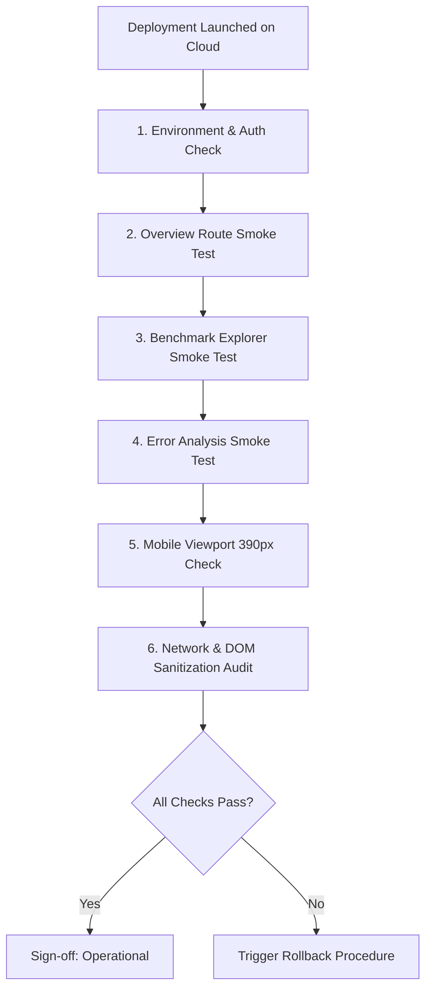

# D4 — Controlled Public Deployment Plan

- **Milestone:** D4
- **Repository:** `CAPTCHA-Quality-Robustness-Analyzer`
- **Subject:** Controlled Public Deployment Plan for Streamlit Community Cloud
- **Target Architecture:** Option A Results-Only Public-Safe Dashboard Profile
- **Status:** Complete (Planning and Audit Specification)
- **Final Classification:** `deployment_plan_ready_for_owner_approval`

---

## Executive Summary

Milestone D3B implemented the Option A results-only dashboard profile, and Milestone D3C independently audited the codebase, confirming that the application enforces an airtight public-safe boundary when `PUBLIC_SAFE_MODE=true` is enabled.

This document establishes the **Controlled Public Deployment Plan** for hosting the results-only research dashboard on **Streamlit Community Cloud**. It defines the exact repository coordinates, packaging boundary, runtime dependencies, public data allowlist, strictly excluded assets, post-deployment smoke test protocol, and immediate rollback procedures.

### Formal Deployment Boundary

1. **Non-Authorization Notice:** This milestone is an audit and deployment-preparation specification. It **does not authorize public deployment**, publish a live URL, or connect repository accounts to cloud hosting providers.
2. **Owner Gate:** Public deployment remains blocked until explicit repository owner authorization is granted.
3. **Legal Disclaimer:** Technical audits, asset separation, and sanitization checks establish engineering compliance with project integrity and licensing constraints (M7E §11 Risk B11); they do not constitute formal legal counsel.
4. **Research Immutability:** Historical research artifacts, benchmark datasets, model checkpoints, and release tag `v1.0.0` remain frozen and unaltered.

---

## 1. Verified Repository State and Release Integrity

All deployment configurations and packaging audits in this plan are anchored to the following verified Git identities:

| Entity | Identifier / Commit Hash | Verification Status |
| :--- | :--- | :--- |
| **Repository Remote** | `https://github.com/yash-mishraa/CAPTCHA-Quality-Robustness-Analyzer.git` | Clean, synchronized with `origin/main` |
| **Target Branch** | `main` | Verified |
| **Current HEAD** | `5926fadf518db249ff63c9f8fe373cd9fb618832` (`docs: audit public-safe dashboard deployment candidate`) | Verified clean |
| **D3B Implementation** | `20b5892d65ad2be3e12d84e9b4cee37dfb9516d8` (`feat: implement results-only public-safe dashboard profile`) | Direct ancestor of HEAD |
| **Release Tag `v1.0.0`** | `9b7b62ff4669c39712b799d22d50b6bbb3e5b9c3` (Tag object: `dd2fcf120597259292f0d826ada6e1ee76a15e45`) | Strictly preserved, unmodified |
| **Working Tree** | Zero untracked files, zero uncommitted modifications | Clean |

---

## 2. Streamlit Community Cloud Platform & Packaging Architecture

### 2.1 Deployment Target Parameters

When authorized, the application will be connected to Streamlit Community Cloud with the following exact deployment parameters:

- **Repository:** `yash-mishraa/CAPTCHA-Quality-Robustness-Analyzer`
- **Branch:** `main`
- **Main file path:** `app/streamlit_app.py`
- **Python version:** `3.12` (selected in Streamlit Cloud deployment modal)
- **App URL slug (custom):** Optional, e.g. `captcha-robustness-analyzer`

### 2.2 Packaging Boundary and Dependency Resolution

Streamlit Community Cloud inspects the repository file tree according to a strict dependency hierarchy:
1. When the main entry point is located in a subdirectory (e.g. `app/streamlit_app.py`), Streamlit Cloud looks first for a dependency manifest in that exact directory (`app/requirements.txt`).
2. If `app/requirements.txt` is present, Streamlit Cloud installs only the packages listed in `app/requirements.txt`, ignoring root-level `pyproject.toml` or `environment.yml`.

This directory-level resolution is critical for security and container isolation:
- The research pipeline dependencies in the root `pyproject.toml` (which include `scikit-learn`, `joblib`, `scikit-image`, and development tools) are **not installed** in the deployment container.
- The cloud container runs with a lean, minimal runtime environment:

```ini
# app/requirements.txt
streamlit==1.50.0
pandas==2.3.3
pillow==11.3.0
altair==5.5.0
```

*Note on Pillow:* `pillow` is pinned because `app/lib/data.py` defines image loading utilities used in local mode. In public-safe mode, no image decoding paths are called.

### 2.3 Server and Browser Configuration

The root `.streamlit/config.toml` is committed and tracked in Git. It is automatically respected by Streamlit Community Cloud:

```toml
[theme]
base = "light"
primaryColor = "#A6402F"
backgroundColor = "#F5F0E6"
secondaryBackgroundColor = "#EBE3D5"
textColor = "#1B1B17"
font = "sans serif"

[server]
headless = true

[browser]
gatherUsageStats = false
```

- `server.headless = true`: Prevents interactive browser popups on startup.
- `browser.gatherUsageStats = false`: Disables all telemetry beacons to Streamlit analytics servers.

### 2.4 Environment Variable and Secrets Configuration

Public-safe results-only mode is activated by setting the environment variable `PUBLIC_SAFE_MODE=true`.

In Streamlit Community Cloud, this must be configured in the deployment settings:
1. Navigate to **App Settings** > **Secrets** (or **Advanced Settings**).
2. Enter the configuration key:
   ```toml
   PUBLIC_SAFE_MODE = "true"
   ```
3. Streamlit Cloud injects root secrets into `os.environ` upon container boot.
4. `app/lib/contracts.py:is_public_safe_mode()` evaluates `os.getenv("PUBLIC_SAFE_MODE")`, matching `"true"`, `"1"`, `"yes"`, or `"on"` (case-insensitive).
5. When active, all image-serving routes, filesystem checks on `images/`, and path resolutions are completely disabled.

---

## 3. Public-Safe Data and Asset Allowlist

The application operates exclusively as a read-only presentation layer. It reads only pinned, frozen artifacts. The complete allowlist consists of 12 tabular CSV files and bundled offline open fonts:

### 3.1 Pinned Tabular Artifacts

| Artifact Path | SHA-256 Digest | Rows | Content & Public Suitability |
| :--- | :--- | :--- | :--- |
| `data/processed/matched_font_benchmark_v0.1.0/manifest.csv` | `35ae405fd084070bf4d6c235638cbda6671573389e880dcca2a63d8b66049743` | 6,300 | Metadata table. In public-safe mode, `image_path`, `reference_path`, `image_sha256`, and `reference_sha256` are stripped upon loading. |
| `data/processed/matched_font_benchmark_v0.1.0/features.csv` | `fa2d79c85d682b26545dc2c4e3ec5ece2a41d85aea7e1ea1070f7256ff8519bb` | 6,300 | Precomputed 8 handcrafted spatial features. Fully public numerical measurements. |
| `reports/matched_font_benchmark_v0_1_0/predictions.csv` | `e6c1f1ba83bbb05c18fed8a9b0dd1c87014a6f6c3667475971b2834dfedd4dd4` | 6,300 | Precomputed model predictions from frozen M5C champion. |
| `reports/matched_font_benchmark_v0_1_0/overall_metrics.csv` | `abbc28d5c73e15091edbf79cc086449d171c91af4233964529811634ed0a79fa` | 10 | Primary aggregate metrics ($R^2$, RMSE, MAE) across benchmark scopes. |
| `reports/matched_font_benchmark_v0_1_0/family_metrics.csv` | Verified in repo | 7 | Aggregate breakdown across corruption families (elastic, gaussian blur, noise, etc.). |
| `reports/matched_font_benchmark_v0_1_0/uncertainty.csv` | Verified in repo | 105 | Clustered bootstrap confidence intervals for primary performance metrics. |
| `reports/matched_font_benchmark_v0_1_0/dataset_composition.csv` | Verified in repo | 60 | Breakdown of font, case, and corruption partition counts. |
| `reports/interference_error_analysis_v0_1_0/summary_metrics.csv` | `6d68e465887e3053e20a7c582f79e8318900e8cd14fb48005f15a54c224f1303` | 9 | M9 summary metrics, tail error rates, and top-source SSE share. |
| `reports/interference_error_analysis_v0_1_0/severity_metrics.csv` | Verified in repo | 19 | Error progression across degradation severities $s \in \{1, 2, 3, 4\}$. |
| `reports/interference_error_analysis_v0_1_0/condition_calibration.csv` | Verified in repo | 9 | Prediction-vs-target variance ratios and calibration slopes. |
| `reports/interference_error_analysis_v0_1_0/error_concentration.csv` | Verified in repo | 9 | Pareto error concentration percentiles ($5\%$, $10\%$, $20\%$). |
| `reports/interference_error_analysis_v0_1_0/font_condition_metrics.csv` | Verified in repo | 80 | Font-family condition cross-tabulations and confidence intervals. |

### 3.2 Bundled Typography Assets

All typography assets are bundled locally in `app/assets/fonts/` and embedded as base64 data URIs via `app/lib/theme.py`:

| Asset File | Format | License | Provenance |
| :--- | :--- | :--- | :--- |
| `IBMPlexSans-Variable.woff2` | WOFF2 | SIL OFL-1.1 (`OFL-IBMPlexSans.txt`) | IBM Plex Open Source Font Project |
| `IBMPlexMono-400.woff2` | WOFF2 | SIL OFL-1.1 (`OFL-IBMPlexMono.txt`) | IBM Plex Open Source Font Project |
| `IBMPlexMono-500.woff2` | WOFF2 | SIL OFL-1.1 (`OFL-IBMPlexMono.txt`) | IBM Plex Open Source Font Project |
| `IBMPlexMono-600.woff2` | WOFF2 | SIL OFL-1.1 (`OFL-IBMPlexMono.txt`) | IBM Plex Open Source Font Project |
| `SourceSerif4-Variable.woff2` | WOFF2 | SIL OFL-1.1 (`OFL-SourceSerif4.txt`) | Adobe Source Serif Open Source Font |

Zero font binaries are downloaded from external CDNs, Google Fonts, or third-party servers.

---

## 4. Strictly Excluded Assets and Enforcement Boundary

The following assets and files are **strictly prohibited** from runtime execution, public serving, or cloud exposure:

| Asset Category | Target Path / Pattern | Exclusion Reason | Enforcement Mechanism |
| :--- | :--- | :--- | :--- |
| **Benchmark CAPTCHA Images** | `data/processed/matched_font_benchmark_v0.1.0/images/**` (6,300 PNGs) | Rendered from proprietary fonts; public hosting disclaimed under M7E §11 Risk B11. | 1. `_validate_manifest_paths` skipped in public-safe mode.<br>2. `data.resolve_image_path` raises `SecurityError`.<br>3. `data.load_selected_image` raises `SecurityError`.<br>4. Views omit `st.image()` calls. |
| **Ground Truth Answer Key** | `data/processed/matched_font_benchmark_v0.1.0/ground_truth.csv` | Research integrity safeguard against training contamination. | 1. Ignored via `.gitignore`.<br>2. Never committed to GitHub repository.<br>3. No loader exists in `app/lib/data.py`. |
| **Model Estimators & Checkpoints** | `models/**`, `*.joblib`, `*.pt`, `*.ckpt` | Research governance; prevent live inference misuse. | 1. Ignored via `.gitignore`.<br>2. Never committed.<br>3. Not installed in `app/requirements.txt`.<br>4. AST token import check rejects `joblib`/`sklearn`. |
| **Proprietary Font Binaries** | `assets/fonts/**` (Arial, Times New Roman, Impact, etc.) | Commercial font license restrictions prohibiting web redistribution. | 1. Uncommitted/untracked.<br>2. Zero references in app codebase.<br>3. Dashboard uses self-contained OFL WOFF2 fonts only. |
| **Internal Development Caches** | `.venv/`, `.pytest_cache/`, `.ruff_cache/`, `reports/_*` | Operational noise, internal exploration scratchpads. | 1. Ignored via `.gitignore`.<br>2. Completely absent from fresh clone. |

---

## 5. Deployment Packaging Boundary Audit

### 5.1 Fresh-Clone Verification

An automated fresh-clone audit was conducted to confirm that a clean clone of the repository contains all necessary code, assets, and data files without relying on local virtual environments or untracked cache files:

1. A clean clone was created in an isolated temporary directory via `git clone`.
2. Under `PUBLIC_SAFE_MODE=true`, `data.read_core(public_safe=True)` successfully loaded:
   - 6,300 benchmark rows.
   - 25 sanitized columns (all image paths and SHA-256 hashes verified absent).
3. All 4 M8 report tables and all 5 M9 report tables were loaded and validated against their schemas.
4. Streamlit headless `AppTest` execution was executed against the root app (`app/streamlit_app.py`) and each view (`overview.py`, `benchmark.py`, `error_analysis.py`).
5. **Result:** Zero exceptions, 100% clean initialization.

### 5.2 Test Suite Execution Protocol

- **Local Development Environment:** Running `.venv-dashboard/bin/python -m pytest app/tests` passes **85/85 tests** (including image verification tests for local mode and isolated public-safe tests with monkeypatched environment).
- **Core Research Verification:** Running `.venv/bin/pytest tests/test_benchmark_lifecycle.py tests/test_release_documentation.py` passes **33/33 tests**.
- **Code Formatting and Linting:** `ruff check app` and `ruff format --check app` pass with zero diagnostics across all 26 files.

---

## 6. Remote Smoke-Testing Protocol

Upon owner authorization and initial cloud deployment, the following manual and automated smoke tests must be executed against the live Streamlit Community Cloud URL before declaring the deployment operational:



### Phase 1: Environment & Configuration Check
- [ ] Confirm sidebar badge displays: `"Results-Only Profile · Public-Safe"`.
- [ ] Confirm sidebar metadata card displays: `"Frozen benchmark results · 5,700 primary evaluation rows"`.
- [ ] Verify Streamlit "Deploy" button and toolbar menu are suppressed via CSS.

### Phase 2: Route `/overview` Smoke Test
- [ ] Verify primary metric cards match authoritative v1.0.0 values:
  - $R^2 = 0.828$
  - $\text{RMSE} = 0.052$
  - $\text{MAE} = 0.038$
  - Evaluated primary rows: $5,700$
- [ ] Verify perturbation family degradation table renders without empty cells.
- [ ] Confirm the Specimen Exhibit panel displays the **Illustrative Record Exhibit Card** (SSIM target $0.769$, prediction $0.893$, residual $-0.124$) and Handcrafted Feature Summary table.
- [ ] Verify **zero `` tags** and zero `st.image()` containers exist on the page.

### Phase 3: Route `/benchmark` Explorer Smoke Test
- [ ] Test filter controls: Font multi-select, Case ID, Variant Family, Severity Level, and Protocol Scope.
- [ ] Verify interactive Altair scatter plot renders all 5,700 primary records.
- [ ] Inspect Vega-Lite JSON payload in browser dev tools:
  - Confirm columns are restricted to: `ssim_target`, `prediction`, `residual`, `font_id`, `variant_family`, `severity_level`, `is_selected`.
  - Confirm **zero filesystem paths** (`images/...`) and **zero SHA-256 hashes** are present in the dataset JSON.
- [ ] Click a record or change selection: verify the Selected Record Exhibit renders metadata chips and features table without image rendering.

### Phase 4: Route `/error-analysis` Smoke Test
- [ ] Verify M9 headline cards match published reports (large-error proportion $1.4\%$, top 5% source SSE share $38.4\%$).
- [ ] Confirm Altair charts render: severity degradation curve, condition calibration slope, and error concentration Pareto chart.
- [ ] Confirm M9A exploratory disclaimer and research non-claims caveats are prominently displayed.

### Phase 5: Mobile Viewport Audit (390px Width)
- [ ] Emulate iPhone 14/15/16 viewport (390 × 844 px) in browser developer tools.
- [ ] Verify sidebar collapses into slide-out drawer.
- [ ] Verify metric cards stack vertically without text truncation.
- [ ] Verify tabular data containers enable horizontal scrolling without page blowout.

### Phase 6: Network Traffic and DOM Audit
- [ ] Open browser DevTools **Network** tab:
  - Verify **zero requests** to `googleapis.com`, `fonts.gstatic.com`, or external CDNs.
  - Verify **zero requests** to `/media/*` or image blobs.
  - Verify all font requests load from embedded data URIs (`data:font/woff2;base64,...`).
- [ ] Inspect DOM: Confirm CSS rule `[data-testid="stToolbar"] { display: none !important; }` successfully hides developer controls.

---

## 7. Rollback Procedure and Operational Controls

### 7.1 Rollback Trigger Conditions

Immediate rollback must be initiated if any of the following occur:
1. **Image Exposure:** Any benchmark image, specimen thumbnail, or binary image blob is rendered in the public UI.
2. **Path or Hash Leakage:** Any local filesystem path (e.g. `/Users/...` or `data/processed/...`) or cryptographic image hash is exposed in user-facing tables, tooltips, or chart JSON.
3. **Metric Discrepancy:** Any headline metric deviates from frozen v1.0.0 values ($R^2 \ne 0.828$, $\text{RMSE} \ne 0.052$).
4. **Data Contamination:** Ground truth character strings or model estimators become accessible.
5. **Security or Stability Anomaly:** Cloud container crashes, infinite re-run loops, or unauthorized external network requests.

### 7.2 Teardown and Rollback Procedures

```
[Level 1 Trigger: Immediate Teardown (< 60 seconds)]
  │
  ├─► Option A: Streamlit Cloud Dashboard (Instant Pause / Delete)
  │     1. Log in to share.streamlit.io.
  │     2. Locate "CAPTCHA-Quality-Robustness-Analyzer".
  │     3. Click App Settings (⋮) -> "Delete App" (or "Pause App").
  │     4. Result: App goes offline immediately; HTTP 404 served.
  │
  ├─► Option B: Environment Variable Killswitch
  │     1. In App Settings -> Secrets, delete or set PUBLIC_SAFE_MODE = "false".
  │     2. App automatically restarts and enters locked state if image paths fail.
  │
  └─► Option C: Git Branch Rollback (if code remediation required)
        1. git revert <commit_hash>
        2. git push origin main
        3. Streamlit Cloud automatically detects commit and redeploys.
```

---

## 8. Go / No-Go Decision Checklist

Before submitting this plan for owner deployment authorization, all preliminary engineering gates must be verified:

| # | Check Item | Status | Verification Evidence |
| :---: | :--- | :---: | :--- |
| 1 | Release tag `v1.0.0` preserved | **PASS** | Verified tag points to commit `9b7b62f` |
| 2 | Working tree clean and synced | **PASS** | Clean status on `main` at `5926fad` |
| 3 | Minimal cloud runtime dependencies | **PASS** | `app/requirements.txt` contains only 4 pinned packages |
| 4 | Model estimators excluded | **PASS** | AST token check passes; zero `.joblib` references |
| 5 | Ground truth excluded | **PASS** | Gitignored; unreferenced in loaders |
| 6 | Benchmark PNGs excluded | **PASS** | Public-safe mode bypasses image paths; `resolve_image_path` raises `SecurityError` |
| 7 | Offline typography self-contained | **PASS** | Bundled WOFF2 fonts with SIL OFL-1.1 licenses |
| 8 | Telemetry and usage stats disabled | **PASS** | `gatherUsageStats = false` in `.streamlit/config.toml` |
| 9 | Public-safe switch tested | **PASS** | `test_public_safe_mode.py` passes 9/9 |
| 10 | Dashboard test suite passes | **PASS** | `pytest app/tests` passes 85/85 |
| 11 | Lifecycle & release tests pass | **PASS** | `pytest tests/test_benchmark_lifecycle.py` passes 33/33 |
| 12 | Linting and formatting clean | **PASS** | Ruff check and format pass 100% (26 files) |
| 13 | Fresh clone execution verified | **PASS** | Clean clone loads 12 allowlisted CSVs and runs headless AppTest |
| 14 | Remote smoke test protocol defined | **PASS** | Documented in Section 6 |
| 15 | Rollback procedures established | **PASS** | Documented in Section 7 |
| 16 | Owner authorization caveat explicit | **PASS** | Documented in Executive Summary and Section 9 |

---

## 9. Final Decision & Milestone Classification

- **Technical Readiness Status:** Fully Prepared and Audited.
- **Milestone D4 Classification:** **`deployment_plan_ready_for_owner_approval`**

### Summary Statement
The controlled deployment plan for the Option A results-only research dashboard is complete, fully audited, and technically verified. The application satisfies all licensing, integrity, and privacy requirements documented in the repository.

**Next Step:** Milestone D4 is concluded. Actual deployment on Streamlit Community Cloud awaits formal owner authorization.
